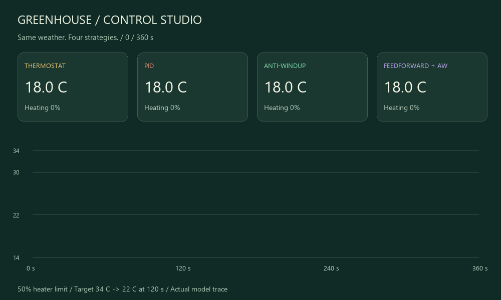

# Greenhouse Control Lab · 智能温室与节能控制

[English](README.en.md) · **[打开互动演示 →](https://flessnerchernosky-ops.github.io/greenhouse-control-lab/?lang=zh)** · [研究路线](ROADMAP.md)

温度控得稳，暖气就一定用得少吗？四间虚构温室面对同样的天气：比较开关控温、普通 PID、抗积分饱和 PID 与前馈，观察误差与加热用量的取舍。



无需器材、注册或安装；中英文界面支持手机。下载后可以直接打开 `docs/index.html`，浏览器没有第三方依赖或数据上传。浅色作品展示与深色实验图表属于同一套 Control Studio 页面设计。

## 3 分钟开始

1. 选择“暖气的欠账”，点击“运行到底”。初始目标 34°C 无法达到；120 秒后目标降为 22°C。
2. 比较普通 PID 与记忆纠偏的温度曲线、末段误差和加热用量。
3. 只改变一个参数，完成新实验，再导出 CSV。语言切换保留记录；场景与参数修改会重置为暂停状态。

## 一组可复现结果

`windup`：延迟 6 s、功率上限 50%、Kp = 0.16、Ki = 0.008、散热估计 1×，总时长 360 s，初始温度 18°C。

| 方法 | 全程 MAE °C | 最后 120 s MAE °C | 满功率等效秒 |
|---|---:|---:|---:|
| 开关控温 | 4.349 | 0.566 | 138.9 |
| 普通 PID | 5.862 | 2.993 | 177.0 |
| PID + 记忆纠偏 | 4.148 | 0.009 | 138.7 |
| 前馈 + 记忆纠偏 PID | 4.185 | 0.011 | 138.2 |

这组条件下，记忆纠偏同时降低误差与加热用量；这不是实际电费或普适节能率。在温和场景中，前馈的全程 MAE 约 0.381°C，比仅记忆纠偏的 0.360°C 更高；冷空气场景中它则改善误差，却略增加加热用量。20 秒延迟仍会产生明显波动，抗积分饱和不能消除传输延迟。

[benchmarks.json](benchmarks.json) 包含 **15 组配置、60 条控制器轨迹的指标**，由 5 个场景 × 3 个延迟 × 4 种方法组成。[data/](data/) 保存五个默认场景的完整原始记录。确定性重跑不构成独立随机重复，也不产生统计置信区间。

## 本地复现

Node.js 18+、Python 3.9+；核心校验只用标准库，无需 npm 或 Python 包。在仓库根目录运行：

```sh
node test.cjs
node benchmark.cjs --check
python verify.py
```

15 项模型与导出检查；全部基准核对；Python 用另一种解析表达式回放热模型并独立计算指标，审核 9,000 行 CSV、36,000 个控制器温度采样。这个独立校验不重新实现控制器，也不能证明算法优越性。

修改模型后使用 `node benchmark.cjs` 生成新数据，保留失败场景并说明修改。可选 `python -m http.server 8000 --bind 127.0.0.1 --directory docs` 提供本地预览。

## CSV 与指标

完成 360 秒后才能导出；文件第一行 `# {...}` 保存场景、设置、步长、时长和完成标志。第二行是字段名，随后 1,800 行采样。Python 可先读首行 JSON，再使用 `csv.DictReader`；pandas 可用 `comment="#"`。

每行记录区间末端温度及上一段 0.2 s 内实际施加的输入；`target_c`、`ambient_c` 是该区间使用的条件。全程 MAE 为等时间采样的绝对温差平均，包含初始过程；末段覆盖 (240,360] s 的 600 个样本。加热用量为 `Σ applied_command × 0.2`，单位是满额定功率等效秒。若额定功率为 P kW，可计算 P × 等效秒 / 3600 kWh，但本项目没有设定真实加热器功率、电价或实测效率。

## 模型与控制

- 一阶模型：`dT/dt = 0.55u − 0.025(T − T_out)`，只有加热。区间内条件常值，采用精确指数更新；dt = 0.2 s，360 s，T(0) = 18°C。
- 34°C 高目标、14°C 室外、50% 功率时，平衡上限只有 25°C。目标不可达，不应把控制器调参当作解决物理能力不足的方法。
- 开关控制使用 ±0.35°C 回差。PID 的 D 对测量求导，经 2 s 低通滤波；Kd = 0.8。
- `raw = Kp × error + I − Kd × filtered_slope + feedforward`，先将 raw 限制到 [0, power]，再更新积分。普通 PID：`I += dt × Ki × error`；记忆纠偏：增加 `0.12 × (limited − raw)` 回算项。
- 前馈使用当前室外温度：`estimate × 0.025 × (target − outside) / 0.55`；没有未来天气预览。
- 输入队列初始为零；延迟必须为 dt 的整数倍。回算处理发出指令的功率饱和，不处理延迟队列尚未执行的命令。
- 控制器读取精确温度，无噪声或传感器估计。未建模植物生长、湿度、主动制冷、太阳辐射、建筑热惯性网络或真实硬件。本项目是原创简化实现，不是新控制算法或真实温室节能证明。

## 继续深入

先完成 [ROADMAP.md](ROADMAP.md) 中一次独立评估：保持相同条件与调参预算，同时报告温度误差、加热用量和失败案例。初始代码和文档由 AI 协助制作；申请材料请说明你实际完成的改动、实验与验证。

原理参考：[MathWorks 回算抗积分饱和](https://www.mathworks.com/help/simulink/slref/anti-windup-control-using-a-pid-controller.html)、[python-control 抗积分饱和示例](https://python-control.readthedocs.io/en/stable/examples/cruise-control.html)。它们是原理与拓展参考；当前版本没有依赖或集成 MATLAB、Simulink 或 python-control。代码使用 [MIT](LICENSE)，贡献见 [CONTRIBUTING.md](CONTRIBUTING.md)。

可选重建动图与封面：安装 Pillow，然后执行 `python build_preview.py`。动图来自保存的 `windup` 轨迹，不是另一套仿真。
